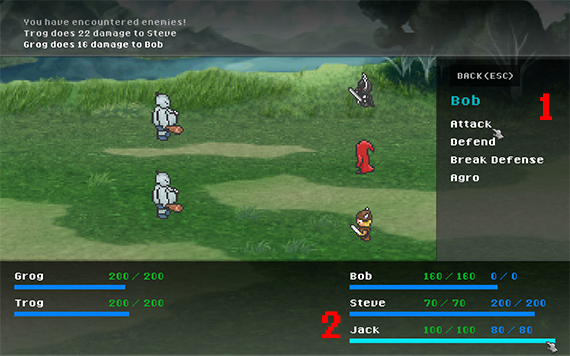

# Battle Scene prototype
Hand-coded in 2014. Just found the files and committed it.
Python/Pygame learning and experimenting with classic Final Fantasy 1 style rpg battle scene

Built in 2014 by Jeff Ruoss (Orc Blade Studios).

## Running it
- Written for **Python 2.7** and **Pygame** (uses Python 2 `print` statements).
- Set `Path.root` in `development.py` to the repo folder (with a trailing `/`), then run `python game.py`.
- `q` quits.

## Credits
- Font: "8-bit Madness" by its original author (see `font/`).
- Battle cry vocals: Dan Hargest.

**NOTE** - For development, the root directory needs to be changed

**game.py** - The main game file

**development.py** - Change start scene or mute music for development. Change root directory

## Layer system
Sprites are grouped into sprite groups named layer_1, layer_2, etc.
This is necessary because the base sprite group class does not draw in a predicatable order.
There are subclasses with order control but the base class is faster.

### The Layers

#### layer_1
- Things that need to be under main game sprites
- UI boxes
- Button backgrounds

#### layer_2
- Main game sprites
- Players
- Enemies
- Menu items

#### layer_3
- Things that need to overlay main game sprites
- Attack slice effects
- Magic effects

### Game State Selector
Is the game scene manager.
It determines the current game state and loads it's update functions, etc.
